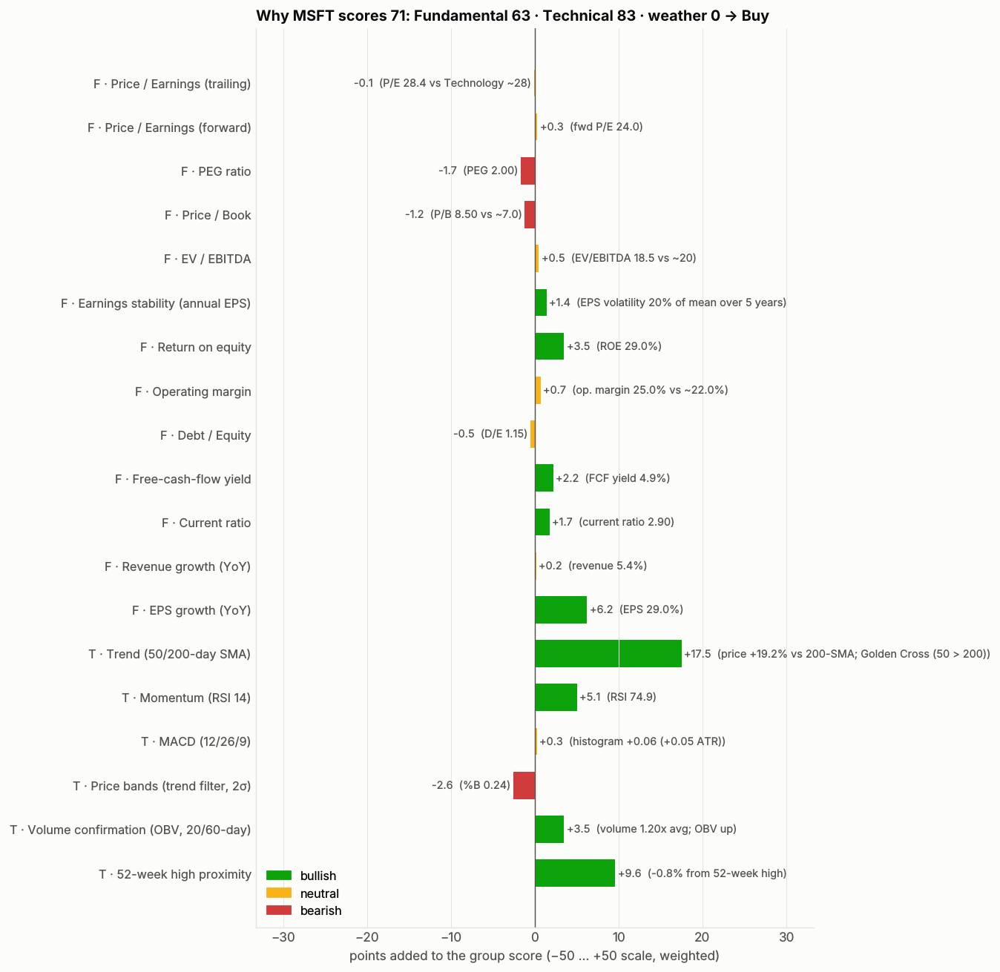
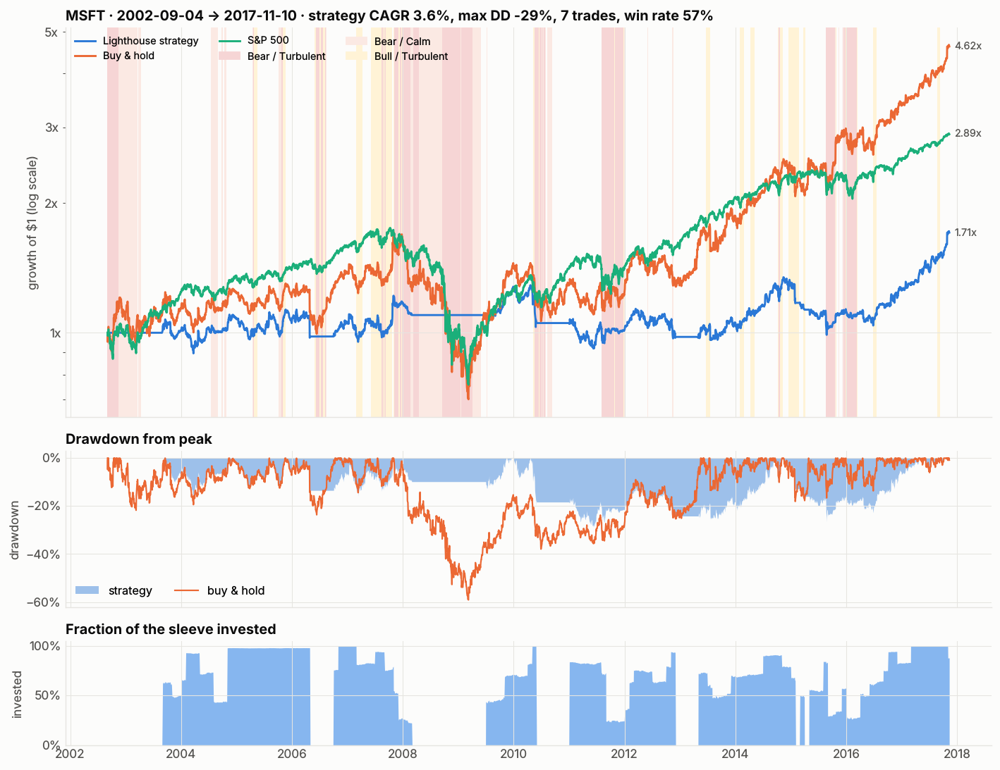

# 🔦 Lighthouse — explainable stock decisions for self-directed investors

*A clear signal in a noisy market.*

Lighthouse turns a ticker and a few facts about **you** — horizon, risk tolerance, the most you accept losing on one
position, the cash you can invest now — into a **Buy / Hold / Sell verdict, a trade ticket for that cash (shares, entry,
stop-loss, take-profit levels, worst-case loss) and the reasons behind it**, then shows honestly how the rules behind it
would have behaved in the past. It also allocates whole portfolios, either a basket you choose or one built for a goal,
with a full risk report.

[](https://colab.research.google.com/github/lotainc0/Stock-Trader-FINTECH-Project/blob/main/notebooks/Lighthouse.ipynb)


| Why does MSFT score 71? | How did the rule behave? |
|---|---|
|  |  |

## What it does

1. **Collects and cleans** daily prices & volume, the S&P 500 and fundamentals (Yahoo Finance → Stooq → cache → bundled real sample data, so it always runs).
2. **Fundamental analysis** — 13 beacons (P/E, forward P/E, PEG, P/B, EV/EBITDA, earnings stability, ROE, margin, debt/equity, FCF yield, current ratio, revenue & EPS growth) scored against sector norms.
3. **Technical analysis** — 6 beacons: trend (50/200-day SMA, Golden/Death Cross), RSI, MACD, position in low-lag price bands (%B around a trend filter, ~1 session of lag), volume confirmation (OBV), 52-week-high proximity.
4. **Market weather** — Bull/Bear × Calm/Turbulent regime of the S&P 500 that penalises scores, raises the entry bar and halves sizes in bear markets.
5. **Decision** — horizon-weighted composite → verdict → position size from the *smallest* of three rules (your max-loss limit, a volatility target, a concentration cap), paid from the **cash you have available** (risk limits are a % of your whole account).
6. **Honest evaluation** — point-in-time backtest vs buy-and-hold and the S&P 500, layer attribution, sensitivity grid, walk-forward out-of-sample test, regime breakdown.
7. **Trade desk** — 📈 long and 📉 short tickets for your cash: limit entry, stop-loss and the exits (long-term buys: the backtest's month-end trend and signal exits, no fixed target; short-term trades and shorts: two take-profit levels in multiples of the risk (R), breakeven and trailing stops, a time stop), a cap on total open risk, and the record of those exact rules on each stock's own history. Every ticket has a **when to get out** table: each exit, for a profit or a loss, with its price, its result for the whole position and how often it happened on the stock's history. "Buy now" orders are priced from a timestamped live quote; signals use finished sessions only.
8. **Portfolio builder** — allocate your basket (equal weight, inverse volatility, risk parity, minimum variance, maximum Sharpe with Bayes-Stein returns, hierarchical risk parity) on a Ledoit-Wolf risk model, with stock/sector caps and a volatility target, or let Lighthouse pick stocks for a goal (preservation, balanced, growth, diversified). You get whole-share orders, VaR / expected shortfall / beta / risk contributions / stress tests, and a walk-forward test of every method.
9. **Watchlist ranking**, plain-English **report**, Streamlit **app**, **CLI**.

## Quick start

```bash
pip install -r requirements.txt
streamlit run app.py            # the web app (opens in your browser)
python -m lighthouse analyze MSFT --horizon long --risk balanced --max-loss 2 --cash 5000 --holdings 20000 --out reports/MSFT --evaluate
python -m lighthouse screen AAPL MSFT NVDA JPM XOM UNH --cash 10000
python -m lighthouse trade MSFT AAPL JNJ XOM --side long --cash 5000        # what to buy right now, with stops and targets
python -m lighthouse portfolio AAPL JNJ XOM JPM KO PG --method risk_parity --cash 10000
python -m lighthouse portfolio --goal balanced --cash 10000                 # Lighthouse picks the stocks
python -m pytest                # 112 tests, runs offline
```

```python
from lighthouse import analyze, InvestorProfile
r = analyze("MSFT", InvestorProfile.from_cash(5_000, holdings_value=20_000, horizon="long", risk="balanced", max_loss_pct=2))
print(r.decision.headline())     # e.g. MSFT: BUY (Lighthouse score 71/100) for a long-term, balanced investor (sample data)
print(r.report())                # the full plain-English report
r.backtest.summary()             # strategy vs buy & hold vs S&P 500

from lighthouse.tradeplan import build_trade_plan
ticket = build_trade_plan(r, "long")         # or "short"
print("\n".join(ticket.management_steps()))  # buy N shares, stop, targets, trailing and time stop
ticket.stats.avg_r                           # how these exact rules did on MSFT's history (R per trade, after costs)

from lighthouse import portfolio as pf
port = pf.build_portfolio(["AAPL", "JNJ", "XOM", "JPM", "KO", "PG"], "risk_parity", capital=10_000)
port.table(); port.risk["var95_1d_usd"]; port.comparison   # orders, risk, walk-forward test of every method
```

No internet? Set `LIGHTHOUSE_OFFLINE=1` (or `--source sample`): the bundled pack holds real Microsoft OHLCV 1986-2017, 19 other S&P 500 stocks and the index to 2022.

## The web app

`streamlit run app.py` starts a point-and-click site with six tabs:

| Tab | What you can do |
|---|---|
| **Analyse a stock** | verdict dial, score waterfall, a position plan sized from your cash with a *what-if* sizer, a long/short **trade ticket** (entry, stop-loss, take-profits, management plan, historical record of the rules), 19 beacons you can filter by light and hover for the reason, a four-panel price / volume / RSI / MACD chart with low-lag price bands that follow the price, range buttons and the backtested entries and exits, the backtest with drawdown and exposure, deep evaluation (layers, sensitivity heatmap, walk-forward), trade list, downloads |
| **Trade desk** | pick a pre-built universe (a sideways-scrolling row: mega caps, dividend & defensive, each sector, semiconductors, sector and index ETFs, all large caps) or type your own, then fund the best **long** or **short** setups from your cash, one ticket each with its *when to get out* table, within a total-risk cap |
| **Portfolio builder** | allocate your own basket with six methods, or let Lighthouse build one for a goal; whole-share orders, risk report (volatility, VaR, expected shortfall, beta, risk contributions, correlations, stress tests) and a walk-forward test of every method |
| **Rank & compare a watchlist** | presets or your own tickers, ranked bar chart, sortable table (select a row for a summary card and a one-click jump to the full analysis), rebased price comparison |
| **Data behind the verdict** | where every number came from: price source and cleaning notes, the fundamental snapshot, every indicator row, market-weather history |
| **How it works** | the method, verdict bands, risk presets, horizon weights and the full user guide |

Every chart is interactive (hover, zoom, PNG download) and every table can be sorted; all numbers download as CSV or Markdown.
The sidebar's *time machine* answers "what would Lighthouse have said on this date?". Keyboard focus is always visible and
no information is carried by colour alone.

### Put it online (free, 5 minutes)

The app runs as-is on [Streamlit Community Cloud](https://share.streamlit.io):

1. Sign in at https://share.streamlit.io with your GitHub account.
2. *Create app* → *Deploy a public app from GitHub* → repository `lotainc0/Stock-Trader-FINTECH-Project`, branch `main`, main file `app.py`.
3. Press *Deploy*. The first build installs `requirements.txt`; after that the app is live at a `*.streamlit.app` URL you can share.

Live data comes from Yahoo Finance (with Stooq as a fallback); the bundled sample pack keeps the app working when a feed is down.

## Results in one table

Long-horizon rule, balanced profile, 20 S&P 500 stocks, Dec 1990 – Dec 2022, 10 bps costs per side, next-day fills
(`reports/examples/cross_ticker_evaluation.csv`, rebuilt by `python scripts/cross_ticker_evaluation.py`):

| | CAGR | Volatility | Sharpe | Max drawdown |
|---|---|---|---|---|
| Buy & hold | 13.3% | 33.5% | 0.50 | −69% |
| Lighthouse signals + regime (fully invested when in) | 10.3% | — | 0.45 | −57% |
| **Lighthouse balanced (vol-targeted)** | 6.2% | 12.3% | 0.38 | **−31%** |
| Lighthouse conservative | 4.5% | 8.6% | 0.31 | −22% |

Lower drawdown and volatility in **20 of 20** stocks; higher Sharpe than buy-and-hold in 3 of 20. Those 20 stocks are
today's survivors, which flatters every rule. On **every S&P 500 member at a past date**, followed until today or until
its prices stop (`scripts/cross_ticker_evaluation.py --cohort DATE`, live data, historical membership):

| Cohort (members with prices / all) | Buy & hold Sharpe | Lighthouse balanced Sharpe | Beats buy & hold (Sharpe) | Equal-weight cohort, a year: buy & hold → Lighthouse |
|---|---|---|---|---|
| 2 Jan 1996, to Oct 2026 (258 / 487, 53%) | 0.36 | 0.13 | 29 of 258 | 11.1% → 4.3% (8.8% → 2.2% if every unpriced member went to zero) |
| 2 Jan 2009, to Oct 2026 (330 / 498, 66%) | 0.48 | 0.23 | 29 of 330 | 17.0% → 4.9% (14.3% → 2.5%) |

We say it out loud: as a way to time single stocks, the rule has shown no edge. It delivers the risk profile you asked
for (lower volatility and drawdown on nearly every stock), at a large cost in return. Cash earned 0% in these tests;
`docs/METHODOLOGY.md` §8 has the details, and `docs/ROADMAP_STATUS.md` the research that follows from it.

## Repository map

```
lighthouse/            the product (pure Python, pandas/numpy/matplotlib)
  config.py            investor profiles, strategy parameters, verdict bands  <- all the numbers to defend
  data.py              live/offline data loading, cleaning report, fundamentals parsing, caching
  indicators.py        causal SMA/EMA/WMA/Hull MA/Holt trend/RSI/MACD/low-lag price bands/ATR/OBV/volatility/drawdown
  technicals.py        technical beacons and score
  fundamentals.py      fundamental beacons, sector norms, point-in-time scores
  regime.py            market weather
  decision.py          composite score, verdict, exit level, position sizing (cash-capped, long or short stops)
  tradeplan.py         long/short trade tickets, exit plan, stop-loss & take-profit management, historical setup test, idea allocation, position replay
  portfolio.py         Ledoit-Wolf / Bayes-Stein estimates, six allocation methods, caps, vol target, risk report, walk-forward test, goals
  universe.py          pre-built universes, curated sector labels (fallback: the fundamentals snapshot's sector)
  backtest.py          point-in-time engine, metrics, layers, sensitivity, walk-forward, regime breakdown
  engine.py            analyze() pipeline and AnalysisResult
  screener.py          watchlist ranking
  report.py            Markdown report
  charts.py            static charts (CLI, report, notebook)
  interactive.py       interactive Plotly charts (web app)
  __main__.py          CLI
app.py                 the web app (Streamlit + Plotly)
notebooks/Lighthouse.ipynb   end-to-end Colab/Jupyter deliverable (built by scripts/build_notebook.py)
data/sample/           bundled real historical data + an offline fundamentals fixture
reports/examples/      example report, charts and the cross-ticker evaluation
docs/                  EXECUTIVE_SUMMARY.md · METHODOLOGY.md · PITCH.md · USER_GUIDE.md · DATA_AND_ML.md
tests/                 85 pytest tests (indicators, scoring, sizing, no-look-ahead, trade tickets, portfolios, pipeline, app)
```

## Limitations

Sector norms are assumptions, not live peer data; Yahoo supplies only ~5 years of statements; the backtests ignore
taxes (and borrow fees for shorts); the strategy backtest checks stops at the close; stops are orders, not guaranteed
prices; the evaluation universes are survivorship-biased. `docs/DATA_AND_ML.md` lists the data sources that would close
these gaps and how machine learning could be added safely. Lighthouse is decision support, not investment advice.

MIT licensed.
